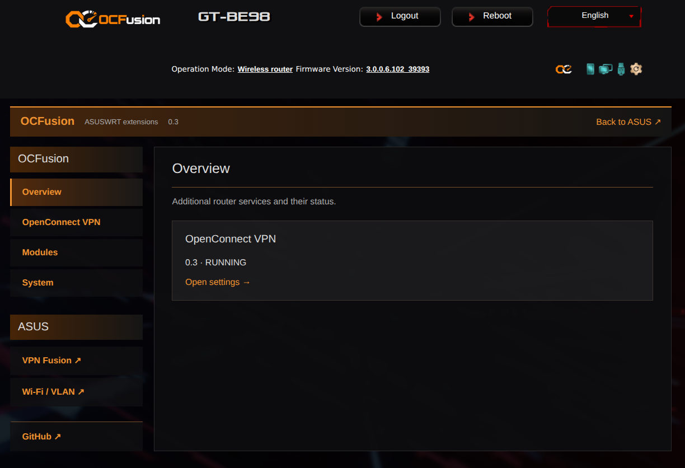
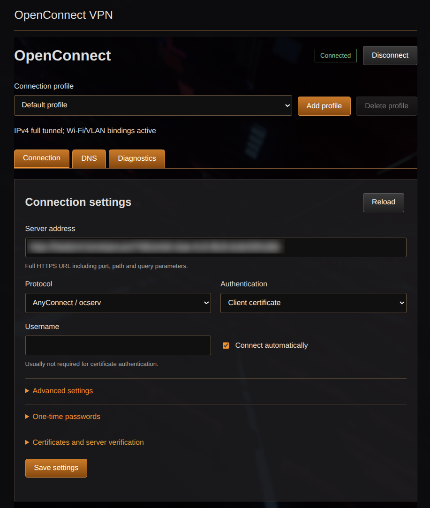
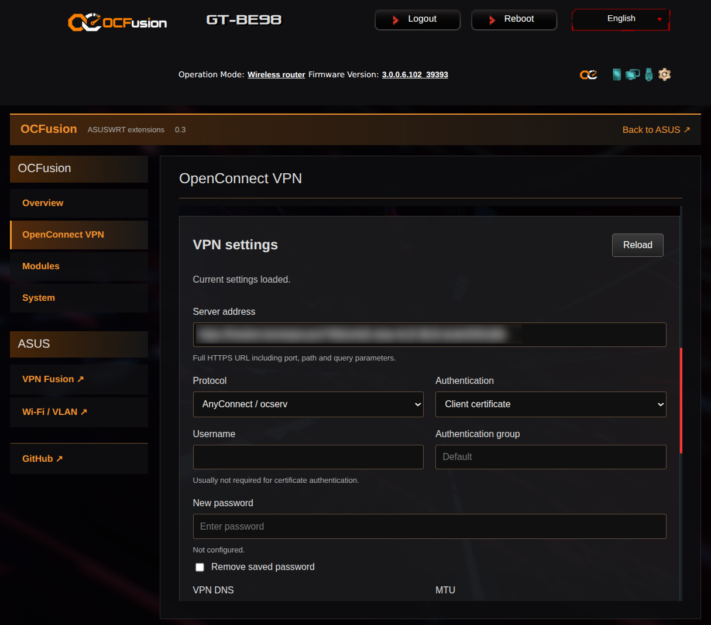

<p align="center">
  <a href="https://github.com/nE0sIghT/ocfusion"></a>
</p>

# OCFusion - all you need is USB flash

OCFusion is a platform for extending stock ASUSWRT functionality without flashing replacement firmware. Its web panel lets you configure and manage extension modules. An ext4-formatted USB flash drive must remain connected while OCFusion is running.

## Available modules

- **OpenConnect** - adds OpenConnect VPN support, with connection settings and status in the OCFusion panel. A selected connection can carry DNS requests for the router and all networks, with automatic WAN fallback when disconnected.

## Compatibility

Tested router: **ASUS GT-BE98**, running stock ASUSWRT **3.0.0.6 build 102 / extension 39393**.

Other routers have not been tested.

## Quick start

The simplest installation uses a USB drive prepared on a Linux computer. Use an ext4 partition with at least 128 MiB free space and leave it connected during operation. Preparation does not format the drive. Stock ASUS Apps autorun must be enabled and another USB drive must not already own the Apps root.

1. Download the runtime archive from [Releases](https://github.com/nE0sIghT/ocfusion/releases).
2. Extract the archive, then prepare the mounted USB partition (replace `/media/user/USB`):

   ```sh
   tar -xzf ocfusion-0.3.1-aarch64.tar.gz
   ./ocfusion/install.sh --prepare-usb /media/user/USB
   ```

3. Safely eject the drive, plug it into the supported router and wait for ASUS Apps startup. Installation runs automatically; SSH is not required for this path.
4. Sign in to your router's ASUS web interface and click the OCFusion icon  in the top-right header.

   

   Configure OpenConnect in the OCFusion panel. In the ASUS settings for your SDN Wi-Fi/VLAN network, select the VPN Fusion profile shown in the OpenConnect module as its VPN connection. Leave this profile's switch **OFF** in VPN Fusion; OCFusion controls the tunnel.

See [installation, updates and troubleshooting](INSTALLATION.md). Reinstalling preserves the profile, Fusion index and network bindings. Updating briefly interrupts the VPN connection.

## Features

- Extend stock ASUSWRT with additional modules without replacing the firmware.
- Manage extensions from a web panel integrated with the ASUS interface.
- Connect to OpenConnect VPN servers using the included module.
- Optionally use a VPN connection for router DNS, with automatic WAN fallback.
- English and Russian UI, following the router's language setting.

## Screenshots

### Overview



### OpenConnect



### VPN settings



## Development

To build OCFusion and run its tests, follow the [build instructions](docs/building.md). The project uses Meson/Ninja, Go and a C cross-compiler.

To create an extension, see the [module development guide](docs/modules.md). The module API is experimental and may change.

See the [architecture overview](docs/architecture.md) for how the platform and modules work together.

## Project and support

[GitHub](https://github.com/nE0sIghT/ocfusion) | [Issues](https://github.com/nE0sIghT/ocfusion/issues) | [Releases](https://github.com/nE0sIghT/ocfusion/releases)

If you want to support the work or say thanks:

- BTC: `bc1q3qmyy5wx8antx2e44lrr4fv9h3z8hs4x7jlnat`
- EVM: `0x6b513f6853003726502ec258351fcf6b82336d49`
- [Boosty](https://boosty.to/ne0sight/donate)

## License

OCFusion is free software licensed under the **GNU General Public License, version 3 or later**. See [LICENSE](LICENSE) for the full license text.

Third-party components retain their own licenses. The runtime distribution includes their required license notices.

Patches to third-party OSS projects are distributed under the licenses of those projects. The OpenConnect patch is licensed under the **GNU Lesser General Public License, version 2.1**.
